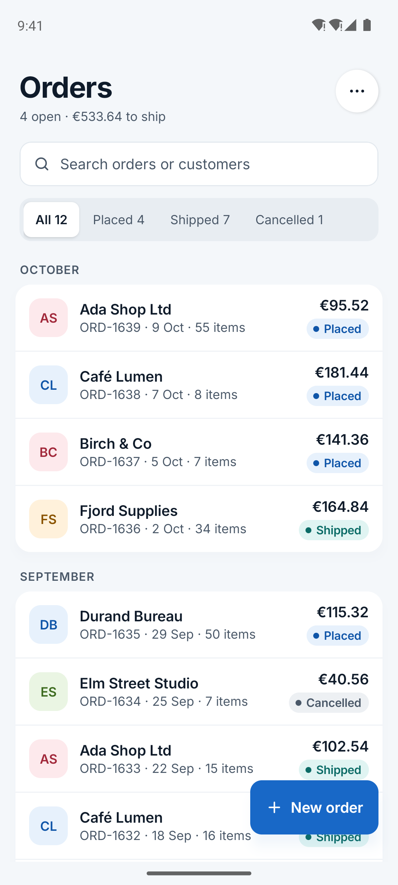
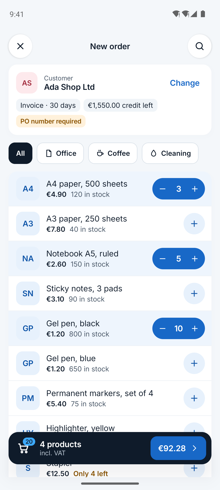
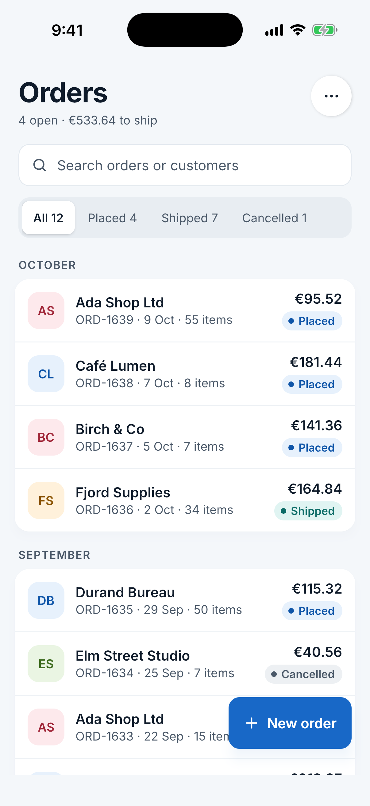
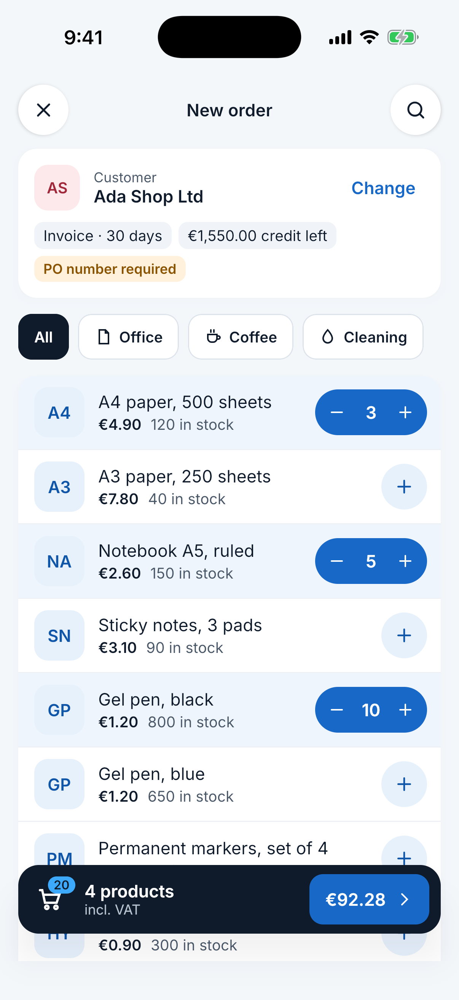
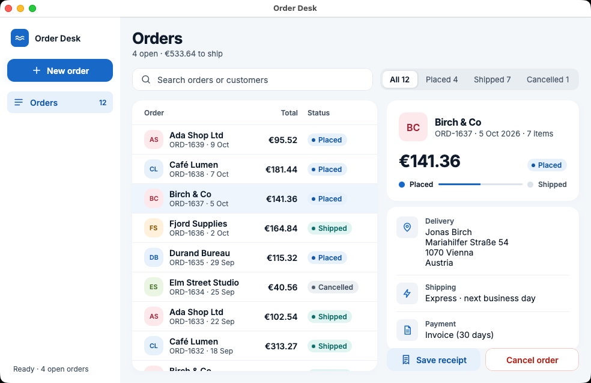
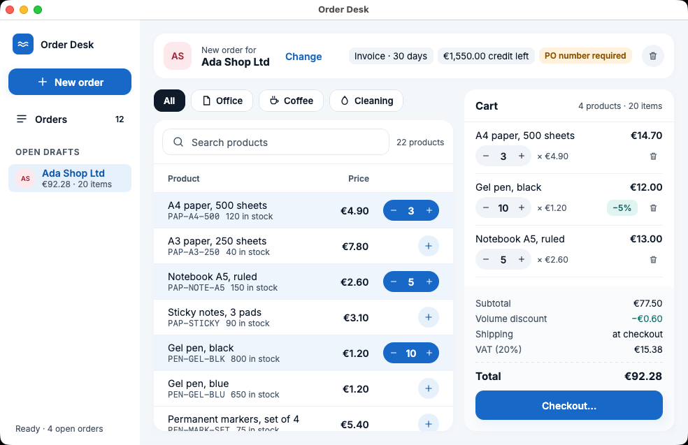
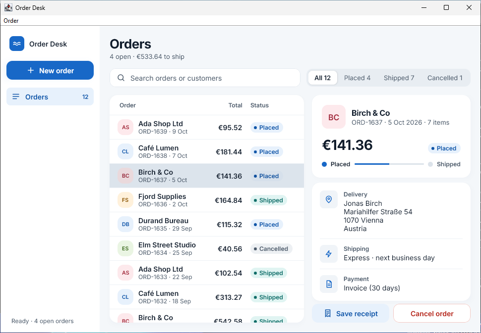
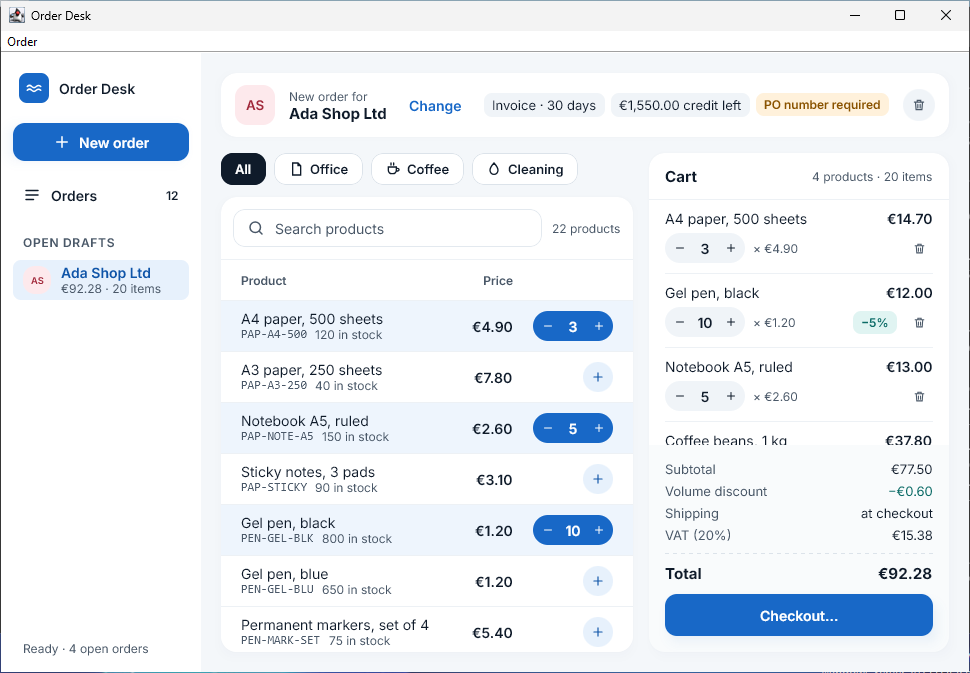
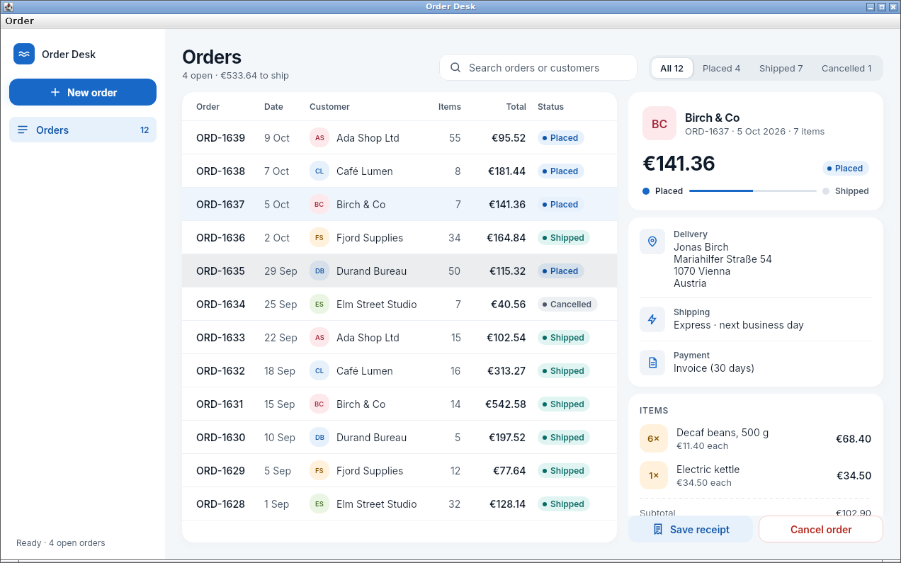
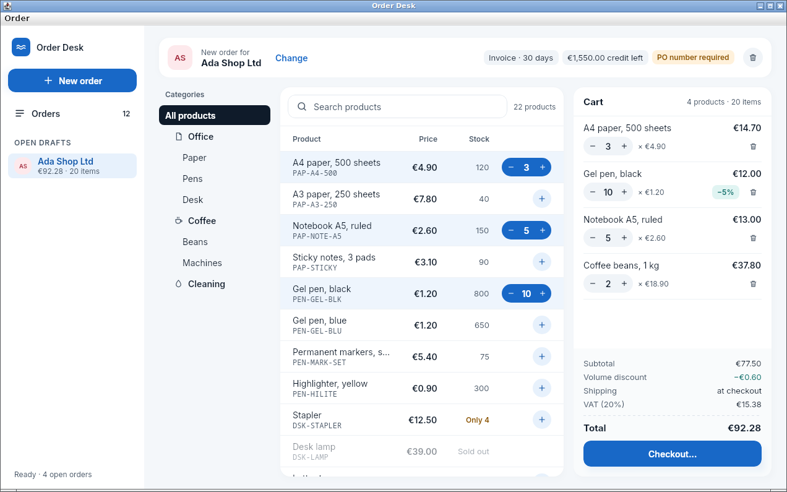

# Order Desk in Compose

Order Desk, a small order entry app where a shop employee takes an order for a customer, written once in
[Compose Multiplatform](https://www.jetbrains.com/compose-multiplatform/) and running on Android, iPhone and iPad,
macOS, Windows and Linux. It is the demo of the [Lagoon theme](https://github.com/kormcrete/swing-flatlaf-lagoon-theme)
for Compose: the same colours, type and shapes on every platform, with sizes that follow the platform, touch on
phones and denser on desktop.

It has the parts real business apps have:

- an orders list with search, status filter and month groups, and an order with delivery, payment, items and totals;
- a new order: customers with their payment terms, products by category or search, a cart with quantity steppers;
- a four-step checkout with rules (postal codes per country, Express only to Germany and Austria, free shipping from
  €100, a PO number for some customers, the credit limit);
- cancelling an order (stock and credit go back) and a receipt;
- one UI that lays itself out as a phone app on narrow screens and as a desktop app on wide ones.

Kotlin, Compose Multiplatform 1.9, JDK 25 on desktop. Customers, products and orders are invented and live in memory:
each start begins with the same data. The same app as a plain Swing application:
[swing-order-desk-demo](https://github.com/kormcrete/swing-order-desk-demo).

<p>
  
  
  
  
</p>
<p>
  
  
  
  
  
  
</p>

<sub>Android, iPhone, macOS, Windows and Linux, top to bottom: the same two scenes of the same code, taken by CI on an
emulator, a simulator and the three desktop systems.</sub>

## One UI, two layouts

The width of the window decides the layout, not the platform:

- **Narrow** (phones, narrow windows): one screen at a time with a back stack; the cart is a floating bar; checkout is a
  full-screen flow with a step bar.
- **Wide** (desktop, tablets in landscape): a sidebar with the open drafts, the orders table next to the selected
  order, categories, products and cart side by side; checkout is a dialog.

The theme decides how it looks, the platform how dense it is: 44 pt touch targets and 15 pt text on phones, 36 px
controls and 14 px text on desktop.

## Run it

Clone this repository and the Lagoon theme side by side; Gradle builds the theme from source until it is published:

```bash
git clone -b compose-theme https://github.com/kormcrete/swing-flatlaf-lagoon-theme.git
git clone https://github.com/kormcrete/compose-order-desk-demo.git
cd compose-order-desk-demo
```

You need a JDK to start Gradle. The build uses JDK 17 and the desktop app JDK 25: Gradle takes installed ones or
downloads them.

- **Desktop:** `./gradlew :desktopApp:run`, or `./gradlew :desktopApp:runRelease` for the shrunk release build.
  Narrow the window below 840 px for the phone layout. ⌘N (Ctrl+N) starts a new order, Esc closes a dialog.
- **Android:** start an emulator or connect a phone, then `./gradlew :androidApp:installDebug`; or open the project in
  Android Studio and run **androidApp**.
- **iPhone and iPad** (on a Mac with Xcode):

  ```bash
  brew install xcodegen
  cd iosApp && xcodegen && open OrderDesk.xcodeproj
  ```

  Pick a simulator, or your device after choosing your team under **Signing & Capabilities**, and press Run. Xcode
  builds the Kotlin part itself.

**Scenes.** A launch option opens a prepared screen, the way the screenshots above are taken: `orders`, `order`,
`new-order`, `cart`, `checkout`, `review`. Desktop: `-Dorderdesk.scene=new-order`; Android:
`adb shell am start -n io.github.kormcrete.orderdesk/.android.MainActivity --es scene new-order`; iOS: the
`ORDERDESK_SCENE` environment variable (Xcode: Edit Scheme › Run › Arguments).

## Installers

```bash
./gradlew :desktopApp:packageReleaseDmg   # macOS
./gradlew :desktopApp:packageReleaseMsi   # Windows
./gradlew :desktopApp:packageReleaseDeb   # Linux
./gradlew :androidApp:assembleRelease     # Android, signed with the debug key
```

`desktopApp/aot/train-and-package.sh` builds the .deb or .dmg with an AOT cache for a faster start (see
[Desktop runtime](#desktop-runtime)).

## Build and test

```bash
./gradlew :shared:jvmTest                         # the model's tests, on the JVM
./gradlew :shared:iosSimulatorArm64Test           # the same tests on iOS (on a Mac)
./gradlew :shared:jvmTest -Pscreenshots=../shots  # also renders the main screens headless into shots/
```

CI builds Android, iOS and the desktop app on Linux, macOS and Windows, runs the tests, renders the screens, measures
the packaged desktop app and takes the screenshots above.

## Project layout

| Module | |
|---|---|
| `shared` | The model (`model`: orders, catalog, cart, pricing, checkout rules; plain Kotlin, with tests) and the UI (`ui`), common to all platforms |
| `androidApp` | The Android app: one activity showing `App()` |
| `iosApp` | The iOS app: a SwiftUI shell around `MainViewController()`, as an XcodeGen project |
| `desktopApp` | The desktop app: window and menu bar, packaging, the memory probe and the window screenshot |

The UI is in `shared/src/commonMain/kotlin/io/github/kormcrete/orderdesk/ui`: `App` picks `PhoneLayout` or
`DesktopLayout`; both use the same parts (`Parts`, `CheckoutSteps`) and the same state (`OrderDeskState`). The look
comes from `lagoon-compose`: `LagoonTheme`, its tokens and components.

## Desktop runtime

A Java desktop app does not have to be heavy. The desktop app ships its own JDK 25 runtime, trimmed to the modules it
uses, shrunk with ProGuard, and starts with:

| Option | Why |
|---|---|
| `-XX:+UseSerialGC`, `-Xms24m -Xmx384m` | A collector made for small heaps, with a cap |
| `-XX:MinHeapFreeRatio=10 -XX:MaxHeapFreeRatio=30` | Gives unused heap back to the system |
| `-XX:+UseCompactObjectHeaders` | Smaller objects (JDK 25) |
| `-XX:+UseStringDeduplication` | Repeated strings stored once |
| `-XX:TieredStopAtLevel=1`, `-XX:ReservedCodeCacheSize=48m` | Quick JIT only: less compiler memory and fewer threads, plenty for UI code |
| `-Xss512k` | Smaller thread stacks |

With `-Dorderdesk.probe=<file>` the app walks through its main screens, then writes what it uses and quits. CI runs it
on the packaged app: the Java heap stays near 10 MB, and the process uses about 220–230 MB resident on Linux, of which
about 100 MB are shared, file-backed pages (the runtime's modules and Skia's native library).

An AOT cache (JDK 25) makes the start faster: classes are loaded and linked once, in a training run, and stored next
to the jars. The JVM uses a cache only with the very same jars, so the script trains the app where its installer puts
it, on the files the installer installs, and adds the cache to that package.

## License

Apache License 2.0. The Lagoon theme bundles the Inter font under the SIL Open Font License.
